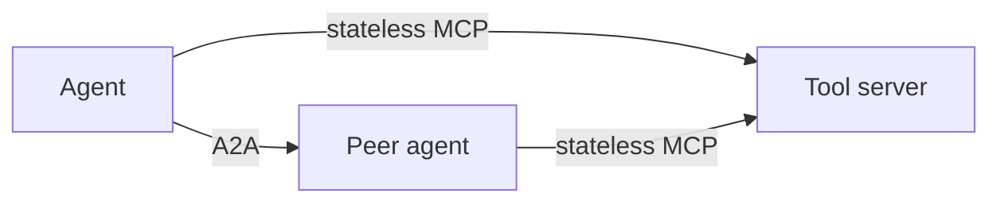

# The Living Agentic Book — 42-session build sprint

**42 sessions · Mon–Sat · 12:30–14:30 learn · 15:30–17:30 build · starting Monday 2026-11-23**

A project-based sprint whose deliverable is not a document but a *system for keeping a document true*: an mdBook that builds to a static, forkable site; a corpus of captured sources; a claims ledger with provenance; a Rust preprocessor that fails the build when evidence is missing; a stateless MCP service that lets agents query the book's own claims; and a maintenance loop that detects staleness and proposes edits a human must merge.

The subject matter is the territory you already have a map of — `evolution-of-ai-agents-and-stateless-mcp.md` — but that document is the *seed*, not the goal. By session 42 you should be able to extend it: add chapters, correct dated claims, and defend every sentence with a source you captured, hashed, and dated.

---

## What "living" means here (operationally, not rhetorically)

A book is living if five things are true, and each one is a build artifact:

| Property | Mechanism | Fails when |
|---|---|---|
| Every claim has evidence | `claims.jsonl` + `[[cite:key]]` resolved by the preprocessor | build error |
| Evidence has provenance | `corpus/` stores bytes + sha256 + `fetched_at` + licence | hash mismatch |
| Freshness is checked | scheduled staleness job revalidates sources, writes `STALE.md` | stale source cited |
| Revisions are reviewable | git history + `review.jsonl` approval ledger | unlogged edit |
| Anyone can rebuild it | one command, no proprietary services, no secrets | fork test fails |

"A living document" usually means "we intend to update it". Here it means the build refuses to lie.

## What it is not

- Not a chatbot over a PDF. The book must be complete and readable with every agent switched off.
- Not a wiki. No anonymous edits, no database, no server required to read.
- Not a RAG demo. Retrieval is one consumer of the corpus; the corpus is the asset.
- Not a rewrite of the source document for its own sake. You extend it where it is thin: the stateless-MCP mechanics, the A2A boundary, the infrastructure economics, and the failure modes the original omits.

## The artifact you are building

```
living-book/
├── book/                     # mdBook source (Markdown only)
│   ├── book.toml
│   ├── src/SUMMARY.md
│   └── src/chapters/*.md     # chapters with YAML front matter
├── corpus/                   # captured sources, content-addressed
│   ├── <sha256>.md|.html|.pdf
│   └── index.jsonl           # url, sha256, fetched_at, licence, etag
├── claims/
│   ├── claims.jsonl          # one claim per line, with source spans
│   ├── review.jsonl          # accept/reject/edit decisions
│   └── sources.yml           # citekey -> metadata
├── tools/
│   ├── mdbook-citations/     # Rust preprocessor (crate)
│   ├── ingest/               # Python: fetch, extract, validate
│   └── mcp-server/           # TypeScript or Rust: stateless MCP
├── eval/                     # rubric, harness, report.md
├── site/                     # build output (gitignored)
└── .github|.forgejo/workflows/
```

## Stack, and why each part is there

| Layer | Choice | Because |
|---|---|---|
| Book | **mdBook** (Rust) | Static HTML + client search, plain Markdown, single binary, trivially forkable |
| Extension | **Rust** preprocessor | The only sanctioned way to change mdBook's output; forces you to learn the summarise/transform protocol |
| Ingestion | **Python** | Fastest path for HTTP, parsing, JSONL, and calling a local model; no need to be heroic |
| Edge service | **TypeScript on Workers** (or Rust on a VPS) | Stateless HTTP is the whole point; a Worker is a stateless function by construction |
| Models | **local llama.cpp**, with pi/opencode/hermes as harnesses | You must be able to run the pipeline offline and read what it did |
| CI | **Forgejo Actions or GitHub Actions**, plus a `make` path | The make path is what makes the fork test real |

No build step may require a proprietary service. If a tool cannot run from a fresh clone on a machine with no accounts, it does not go in the critical path.

## The daily shape

| Time | Half | What happens |
|---|---|---|
| 12:30–14:30 | **Learn** | Read the assigned documentation — before touching the code. Write notes with the questions you cannot answer yet. |
| 14:30–15:30 | Break | Walk. Do not debug. The break is where the design usually resolves itself. |
| 15:30–17:30 | **Build** | Produce the day's tangible artifact. Commit it. Ten lines on what broke. |
| 17:30–17:40 | Close | `git status` clean, note written, tomorrow's reading skimmed. |

The halves are deliberately unequal in kind: reading gives you the vocabulary, building gives you the scars. If the build half runs long, cut scope to the deliverable — never borrow from the learning half. Every session's learning half has a documentation target; if you skip it you will spend week 3 fighting Rust errors you could have read about in week 3's reading.

## The seven weeks

| Week | Dates | Theme | Branch | End-of-week artifact |
|---|---|---|---|---|
| 1 | 23–28 Nov | The book as a build artifact | foundations | v0.1.0 live: 3 chapters, CI, gates |
| 2 | 30 Nov–5 Dec | Information architecture | content | v0.2.0: 6 chapters, citations, search, diagrams |
| 3 | 7–12 Dec | Rust: extending mdBook | tooling | citation preprocessor v1.0 used by CI |
| 4 | 14–19 Dec | Ingestion: sources → claims | pipeline | v0.3.0: 10 sources, 60 reviewed claims |
| 5 | 21–26 Dec | Stateless MCP for the book | service | deployed 4-tool endpoint, stateless contract tests |
| 6 | 28 Dec–2 Jan | Trust: evaluation, staleness, red team | quality | v0.9.0-rc with eval report |
| 7 | 4–9 Jan | Synthesis: extend the document | integration | **v1.0.0**, forkable, maintained by a loop |

Weeks 1–2 are content-heavy (you can write before you can build), weeks 3–5 are where the branches diverge (tooling, pipeline, service), and weeks 6–7 converge. If a week slips, slip *within* the branch: the sequence matters less than finishing each artifact before the next week starts.

## Prerequisites

- Rust toolchain (`rustup`), Node 20+, Python 3.12+, git, make, a text editor you can drive blind.
- 20 GB free: Rust build artifacts are the surprise cost, followed by corpus PDFs.
- `mdbook` binary: `cargo install mdbook` (or your package manager). Pin the version in `book.toml`-adjacent docs; a preprocessor compiled against a different mdBook version is the classic week-3 dead end.
- A local model server (week 4 onward) — llama.cpp; 8 GB RAM is enough for a small instruct model at Q4.
- Optional: a domain. Optional: any account at all. The self-hosted path (Caddy on your LAN) is a first-class option, not a fallback.

## Assessment: what "done" means each day

A session counts when all four are true:

1. The deliverable exists and is committed.
2. The learning half produced notes with at least one *unresolved question*.
3. The gate for that week passes (links, build, tests, eval — whichever exists by then).
4. You can explain the diff without reading it.

Weekly, on Saturday: tag, changelog entry, retro (what broke, what you would do differently, what you are deferring). The retro is not ceremony — it is where you decide next week's scope.

## Definition of done for v1.0.0 (session 42)

- `git clone && make` produces the site offline, on a clean machine, with no accounts.
- Every chapter's claims resolve to sources in the corpus; zero orphan citations.
- The MCP endpoint exposes search, claim lookup, source listing, and edit proposals; two contract tests prove it holds no session state.
- `STALE.md` can be generated on demand and names affected chapters.
- An eval report exists with a rubric, scores, and the disagreements left unresolved.
- A stranger has forked it and deployed it (session 41), and their notes are in `FORK-TEST.md`.
- `OPERATING.md` states the monthly loop and the dependency budget.

## Publishing paths (pick one, document the other two)

| Path | Command | Trade-off |
|---|---|---|
| GitHub Pages | push to `main`, Actions deploys `site/` | convenient, largest reach, Microsoft-owned |
| Codeberg Pages | push, Forgejo Actions builds, Pages serves | values-aligned, smaller, still free |
| Self-hosted | `mdbook build`, Caddy serves `site/` on your LAN or VPS | maximum control, your uptime, your TLS |

Because the output is static files, switching is a DNS change. That is the actual forkability guarantee: not "you may fork", but "forking costs twenty minutes".

## Calendar

`sprint.ics` contains **84 VEVENTs** — 42 sessions × 2 halves — because a 4-hour block with a 1-hour gap is two appointments, not one. Each event carries the half's focus, the day's deliverable, and 2–4 documentation links (text only, no video). Times are floating (12:30 and 15:30 wherever the calendar is).

- Same weekdays as your 06:00 plan, so 23 Nov–9 Jan now has two sprints. They do not conflict by clock, but they do collide by *attention*: 6 hours of structured work per weekday. If that is the intent, fine — but the 14:30 break is not optional, and Sundays must stay empty.
- Week 5 (21–26 Dec) is Christmas week again. Session 25–30 are the lightest reading load of the sprint by design; alternatively shift everything: `python build_sprint.py 2027-01-04`.
- Missed a session? Do not compress two builds into one afternoon. Move the session to Sunday and keep the sequence; the branch structure tolerates a day's delay and punishes skipping.

## Where the background material lives

| File | What it is |
|---|---|
| `reference/CONTENT-MODEL.md` | The schema: chapter front matter, claim record, source record, ledger, gates. Read before session 4. |
| `reference/BOOK-SKELETON.md` | The proposed table of contents: how the source document's seven sections become chapters, and which new chapters you are adding. Read before session 7. |
| `reference/PLATFORM-AND-TOOLS.md` | Version pins, install commands, and the fallbacks when a tool is unavailable. |
| `reference/READING-INDEX.md` | Every URL in the sprint, deduplicated. |

Start with `week-01.md`. Session 1 is small on purpose: one repository, one chapter, one honest definition of the problem.


# Week 1 — The book as a build artifact

**23–28 Nov 2026 · artifact: v0.1.0 live — 3 chapters, CI, gates that fail**

You cannot design a living book until you have built a dead one and felt where it hurts. This week you build the smallest honest version: a repository that compiles Markdown into a static site, deploys itself, and refuses to publish when a promise is broken.

Sessions 1–3 are mechanics; 4–5 are the content model and the gates; 6 is the first release. Do not start writing the real chapters until session 4 — you would write prose the model cannot hold.

---

## W1D1 · Mon 23 Nov · What a living book is, and is not

**Learn (12:30–14:30).** Read the mdBook introduction and skim the CommonMark spec's block structure. Write one page answering: who is the reader, what do they need to verify, and what would make this book wrong in a year? The answer to the third question is your maintenance design.

**Build (15:30–17:30).**

```bash
cargo install mdbook --locked      # pin: record the version in the repo
mdbook init living-book --title "The Stateless Agent Book"
cd living-book && mdbook serve --open
git init -b main && git add -A && git commit -m "chore: mdbook skeleton"
```

Replace the generated `src/chapter_1.md` with a real first chapter: the thesis in six sentences, and a "How to read this book" section that states the evidence convention (claim → source → date). That convention is a promise; sessions 4–5 make it enforceable.

**Read.** <https://rust-lang.github.io/mdBook/> · <https://spec.commonmark.org/> · <https://rust-lang.github.io/mdBook/guide/creating.html>

**Deliverable.** A repository that serves locally, with one chapter you would let someone read.

**Check.** `mdbook build` from a clean shell produces `book/` with no warnings; the chapter's claims are already phrased so a source could be attached.

---

## W1D2 · Tue 24 Nov · Book mechanics: SUMMARY, book.toml, themes

**Learn.** Read the configuration and theme pages. Understand which knobs are structural (`src`, `build-dir`, preprocessor sections) and which are cosmetic, and what `mdbook test` does and does not cover (it runs Rust code blocks, not prose).

**Build.**

```toml
# book/book.toml
[book]
title = "The Stateless Agent Book"
authors = ["you"]
language = "en"
src = "src"

[build]
build-dir = "../site"
create-missing = false

[output.html]
git-repository-url = "https://example.org/you/living-book"
edit-url-template = "{git-repository-url}/edit/main/book/{path}"
additional-css = ["theme/extra.css"]
```

Restructure into three chapters (`SUMMARY.md`), add a theme override, and test the built-in search with ten queries you actually expect a reader to type. Note which queries fail — those become chapter headings in week 2.

**Read.** <https://rust-lang.github.io/mdBook/format/configuration/index.html> · <https://rust-lang.github.io/mdBook/format/theme/index.html> · <https://rust-lang.github.io/mdBook/cli/test.html>

**Deliverable.** Three chapters, a theme, and a written note on the search queries that failed.

**Check.** `create-missing = false` means a `SUMMARY.md` entry with no file breaks the build. Prove it, then fix it.

---

## W1D3 · Wed 25 Nov · Forkable publishing, three ways

**Learn.** Read the Pages documentation for one hosted option and one self-hosted option. The question is not "how do I deploy" but "what must a stranger do to deploy *their* fork", including the parts that are not in the docs: secrets, build minutes, cache.

**Build.** A CI workflow that builds and publishes `site/` on push to `main`. Then verify from a phone, on mobile data, and write `FORK.md`: prerequisites, commands, what to change, what will break.

```yaml
# .github/workflows/pages.yml (or .forgejo/workflows/pages.yml — same shape)
on: { push: { branches: [main] } }
jobs:
  build:
    runs-on: ubuntu-latest
    steps:
      - uses: actions/checkout@v4
      - run: cargo install mdbook --locked
      - run: mdbook build book
      - uses: actions/upload-pages-artifact@v3
        with: { path: site }
```

**Read.** <https://docs.github.com/en/pages> · <https://codeberg.org/Codeberg/pages-server> · <https://forgejo.org/docs/latest/>

**Deliverable.** A live URL, plus `FORK.md` you have followed once from a fresh clone.

**Check.** You can name the three things that would break if the hosting provider disappeared, and the DNS change that fixes each.

---

## W1D4 · Thu 26 Nov · Content model v0: claims, sources, provenance

**Learn.** Read PROV-O's core vocabulary and skim a model card. The question to answer: what is the minimum metadata that lets a reader answer "how do you know?" without emailing you? Compare your answer with `reference/CONTENT-MODEL.md` and note where you disagree — that disagreement is yours to resolve in the schema.

**Build.** Write `claims/claim.schema.json` (JSON Schema) and a front-matter convention. Convert one chapter so every paragraph maps to a claim record.

```json
{
  "$schema": "https://json-schema.org/draft/2020-12/schema",
  "type": "object",
  "required": ["id", "chapter", "text", "strength", "sources", "status", "updated"],
  "properties": {
    "id": {"type": "string", "pattern": "^claim-[0-9]{4}$"},
    "strength": {"enum": ["asserted", "hedged", "contested", "estimated"]},
    "sources": {"type": "array", "minItems": 1},
    "status": {"enum": ["draft", "reviewed", "stale"]}
  }
}
```

**Read.** <https://www.w3.org/TR/prov-o/> · <https://arxiv.org/abs/1810.03993> · <https://json-schema.org/>

**Deliverable.** Schema + one converted chapter + a note listing what you cannot yet express.

**Check.** Take the weakest sentence in the chapter and try to fill its claim record. If you cannot pick a `strength` value, the sentence is the problem, not the schema.

---

## W1D5 · Fri 27 Nov · Build gates: links, structure, tests

**Learn.** Read the linkcheck and git-hooks documentation. Decide, per gate, whether it fails the build or opens a report — a gate that only warns is a gate you will ignore by week 3.

**Build.** `pre-commit` hook and CI job running build + linkcheck. Then break a link deliberately, commit, and record both failures (local and CI) in `notes/gates.md`.

```bash
cargo install mdbook-linkcheck
cat >> book/book.toml <<'EOF'
[preprocessor.linkcheck]
warning-policy = "error"
EOF
cat > .git/hooks/pre-commit <<'EOF'
#!/bin/sh
set -e
mdbook build book --dest-dir ../site >/dev/null
mdbook-linkcheck book
EOF
chmod +x .git/hooks/pre-commit
```

**Read.** <https://github.com/Michael-F-Bryan/mdbook-linkcheck> · <https://git-scm.com/docs/githooks> · <https://docs.github.com/en/actions>

**Deliverable.** Gates green, plus a note documenting one deliberate failure and the exact error text.

**Check.** `git commit` with a broken link must fail *before* the commit exists. `git log` proves it.

---

## W1D6 · Sat 28 Nov · Synthesis: publish v0.1.0

**Learn.** Read the SemVer spec and the Keep a Changelog rationale. For a document, what is a breaking change? (Answer: retracting a claim, or changing one's meaning — not adding a chapter.)

**Build.** Three chapters rewritten from the source document, deployed, tagged.

```bash
git tag -a v0.1.0 -m "three chapters, CI, gates"
git push --follow-tags
```

Write `RETRO.md`: what broke, what you would do differently, what you are deferring to week 2. Include the honest line: "the content model is still theoretical".

**Read.** <https://semver.org/> · <https://keepachangelog.com/en/1.1.0/>

**Deliverable.** v0.1.0 live and tagged; `RETRO.md` committed.

**Check.** A reader can go from the live site to the repository in one click, and from the repository to a running local copy in one command.


# Week 2 — Information architecture

**30 Nov–5 Dec · artifact: v0.2.0 — 6 chapters, bibliography, working search, three diagrams**

Week 1 made a site. This week makes a book: an argument with a shape, citations that resolve, search that answers real questions, and diagrams that assert something. The content model stops being theoretical and becomes a file the build reads.

Read `reference/BOOK-SKELETON.md` before session 7. You are not inventing the structure from scratch; you are testing whether the proposed one survives contact with the source document.

---

## W2D1 · Mon 30 Nov · Outline: turning a document into a book

**Learn.** Re-read the source document for its *skeleton*: where it asserts, where it argues, where it merely narrates. Mark every sentence that would need a source, and every sentence that is a prediction wearing the clothes of an observation.

**Build.** `OUTLINE.md`: twelve chapters, each with a one-line thesis and a claim inventory (one line per claim, with `?` where no source exists yet). Keep a `legacy_text` column so nothing from the original is lost.

```markdown
| Ch | Thesis | Claims | Sourced | Gaps |
|----|--------|--------|---------|------|
| 5  | The 2026-07-28 revision removed protocol state | 18 | 0 | spec not yet captured |
```

**Read.** <https://spec.commonmark.org/> · <https://www.w3.org/TR/prov-o/> · <https://json-schema.org/>

**Deliverable.** `OUTLINE.md` with twelve chapters and a gap count per chapter.

**Check.** Chapter 5 (the stateless mechanics) should have the worst sourced/claims ratio in the table. If it does not, you are being generous with the source document.

---

## W2D2 · Tue 1 Dec · Citations: keys, bibliography, sources.yml

**Learn.** A citation is a claim *about a document*: that it exists, says this, and said it on a date. Read the PROV-O section on derivation and decide which fields your `sources.yml` must carry to make that claim checkable.

**Build.** `sources.yml` with twenty entries, `[[cite:key]]` syntax, and a Python expander that renders bibliography entries and fails on unknown keys (the Rust version arrives in week 3; do not gold-plate this one).

```yaml
# claims/sources.yml
mcp-spec-2026-07-28:
  title: "Model Context Protocol specification, revision 2026-07-28"
  publisher: "Model Context Protocol project"
  url: "https://modelcontextprotocol.io/specification/2026-07-28"
  fetched: 2026-11-23
  sha256: "9f2c..."
```

```python
# tools/ingest/cite.py — the v0 expander
import re, sys, yaml, pathlib
sources = yaml.safe_load(open("claims/sources.yml"))
def expand(text: str) -> str:
    def sub(m):
        key = m.group(1)
        if key not in sources:
            sys.exit(f"unknown citekey: {key}")
        s = sources[key]
        return f"[{s['title']}]({s['url']})"
    return re.sub(r"\[\[cite:([a-z0-9.\-]+)\]\]", sub, text)
```

**Read.** <https://www.w3.org/TR/prov-o/> · <https://arxiv.org/abs/1810.03993> · <https://docs.python.org/3/library/hashlib.html>

**Deliverable.** Twenty sources, ten rendered citations, and a demonstrated failure on a bad key.

**Check.** Every `[[cite:...]]` in the repo resolves; grep for `cite:` and compare with `sources.yml` by eye once, then script it.

---

## W2D3 · Wed 2 Dec · Search: built-in index vs Pagefind

**Learn.** Read the Pagefind docs on indexing and the mdBook search configuration. Understand what client-side search can and cannot do: no synonyms, no phrase ranking across chapters, and an index that ships to every reader.

**Build.** Add Pagefind after the mdBook build, then run the ten queries from week 1 and record the before/after in `notes/search.md`.

```bash
mdbook build book
npx pagefind --site site
# then include the generated UI or call the JS API from your theme
```

The decision to document: built-in search is one file and zero dependencies; Pagefind is a better index and one more build step. State which you chose and the condition under which you would switch.

**Read.** <https://pagefind.app/docs/> · <https://rust-lang.github.io/mdBook/format/configuration/index.html>

**Deliverable.** Working search plus a before/after table for the ten queries.

**Check.** Search works from a `file://` copy of `site/` with no network. If it does not, the index is not static.

---

## W2D4 · Thu 3 Dec · Diagrams as text

**Learn.** Compare Mermaid and Graphviz for the three diagrams you need. The rule: if the diagram asserts a mechanism, its source must be data you can regenerate; if it asserts a timeline, its dates must be claims.

**Build.** Three diagrams — era timeline, MCP/A2A split, ingestion pipeline — each as text, each with alt text and a caption naming its evidence.

````markdown

````

**Read.** <https://mermaid.js.org/> · <https://graphviz.org/documentation/> · <https://github.com/badboy/mdbook-mermaid>

**Deliverable.** Three diagrams committed as text, with captions.

**Check.** Change one date in your outline and regenerate the timeline. If that requires editing an image, the diagram is not yet a claim.

---

## W2D5 · Fri 4 Dec · Chapter 4 with evidence

**Learn.** Writing a claim-backed section: how much hedging each `strength` value implies, how to cite a mechanism without citing a marketing page, and how to write a sentence you would defend in review.

**Build.** Draft `ch04-native-reasoning.md`: eight claims, each with a source, a strength, and a confidence. Rewrite the source document's sentences rather than paraphrasing them — you are correcting, not summarising.

Pay attention to the two sentences in the source document that conflate *vendor claims* with *published results*. Splitting them is the exercise.

**Read.** <https://spec.commonmark.org/> · <https://www.w3.org/TR/prov-o/>

**Deliverable.** One chapter, eight claims, eight citations, zero unsourced assertions.

**Check.** Hand the chapter to someone who has not read the source document. Can they find the evidence for each claim without asking you? If not, the citations are decorative.

---

## W2D6 · Sat 5 Dec · Synthesis: v0.2.0

**Learn.** Build the review checklist you will use for the rest of the sprint: every claim cited, no orphan sources, headings phrased as questions a reader would ask, no "increasingly" without a date.

**Build.** Six chapters, bibliography page, search, diagrams. Run the checklist, fix what it catches, tag.

```bash
git tag -a v0.2.0 -m "six chapters, bibliography, search, diagrams"
```

**Read.** <https://semver.org/> · <https://keepachangelog.com/en/1.1.0/>

**Deliverable.** v0.2.0 deployed; checklist committed as `REVIEW.md`.

**Check.** Run `REVIEW.md` against week 1's chapters. You should fail at least three checks — if you pass all of them, the checklist is too soft.

# Week 3 — Rust: extending mdBook

**7–12 Dec · artifact: `mdbook-citations` v1.0, used by CI**

mdBook is not extensible by config alone. The three ways to change it are the theme, a preprocessor, and a renderer. This week you write the middle one: a Rust binary that mdBook pipes the whole book through, which resolves cite keys, injects evidence blocks, and fails the build when a claim has no source.

The Rust is deliberately narrow: stdin/stdout JSON, a tree walk, a regex, and an error path. No async, no lifetimes you cannot explain.

---

## W3D1 · Mon 7 Dec · Rust for this job, not all of Rust

**Learn.** Read the Rust Book's ownership chapter and the "guessing game" chapter. Then read the preprocessor protocol page *before* writing code — the protocol is the real requirement, the language is the obstacle.

**Build.** `cargo new --bin wordcount`, read a directory of Markdown, print per-file word counts. Wire it into `tools/` and commit.

```bash
rustup update stable
cargo new --bin tools/wordcount
cd tools/wordcount && cargo run -- ../../book/src
```

**Read.** <https://doc.rust-lang.org/book/> · <https://doc.rust-lang.org/book/ch04-00-understanding-ownership.html> · <https://rust-lang.github.io/mdBook/for_developers/preprocessors.html>

**Deliverable.** A Rust binary you can explain line by line.

**Check.** Change the function to take `&str` instead of `String` and get it to compile without cloning. When you can say *why* that worked, the chapter is learned.

---

## W3D2 · Tue 8 Dec · Parsing Markdown as events

**Learn.** pulldown-cmark emits an event stream, not a DOM. Read the event types and the offset API. Understand why regex over rendered HTML is the wrong layer, and why regex over raw Markdown is *almost* right until a code fence contains a citation.

**Build.** A tool that walks the events, counts `[[cite:key]]` and `claim id=...` occurrences, and reports file, line, and key.

```rust
use pulldown_cmark::{Parser, Event};

let mut depth = 0usize;
for (ev, range) in Parser::new(&src).into_offset_iter() {
    match ev {
        Event::Code(_) => {}                       // inline code: ignore
        Event::Start(_) => depth += 1,
        Event::End(_) => depth = depth.saturating_sub(1),
        Event::Text(t) if depth == 0 => { /* scan for [[cite:...]] */ }
        _ => {}
    }
}
```

**Read.** <https://docs.rs/pulldown-cmark> · <https://spec.commonmark.org/>

**Deliverable.** An inventory report generated from the Markdown itself, not from grep.

**Check.** Put `[[cite:foo]]` inside a fenced code block and confirm it is *not* counted. That single test separates a parser from a search engine.

---

## W3D3 · Wed 9 Dec · Preprocessor v1

**Learn.** The protocol in full: mdBook runs your binary with `supports <renderer>` and with no arguments (book JSON on stdin, book JSON on stdout). Errors go to stderr and exit non-zero. There is no daemon and no filesystem contract — which is exactly why it is easy to test.

**Build.** The real thing: rewrite `[[cite:key]]` into a link plus an evidence badge; unknown key aborts the build with `file:line`.

```rust
use mdbook::book::{Book, BookItem};
use mdbook::errors::Result;
use mdbook::preprocess::{CmdPreprocessor, Preprocessor, PreprocessorContext};

struct Citations;

impl Preprocessor for Citations {
    fn name(&self) -> &str { "citations" }
    fn supports_renderer(&self, r: &str) -> bool { r == "html" }

    fn run(&self, _ctx: &PreprocessorContext, mut book: Book) -> Result<Book> {
        let mut err: Option<String> = None;
        book.for_each_mut(|item| {
            if let BookItem::Chapter(ch) = item {
                match rewrite(&ch.content) {
                    Ok(s) => ch.content = s,
                    Err(e) => err.get_or_insert(e),
                }
            }
        });
        match err { Some(e) => Err(anyhow::anyhow!(e)), None => Ok(book) }
    }
}
```

```toml
# book/book.toml
[preprocessor.citations]
command = "mdbook-citations"
renderer = ["html"]
```

**Read.** <https://rust-lang.github.io/mdBook/for_developers/preprocessors.html> · <https://docs.rs/mdbook/latest/mdbook/preprocess/trait.Preprocessor.html>

**Deliverable.** A preprocessor running inside the real build, with a tested failure path.

**Check.** `mdbook build` with a bogus citekey fails and names the chapter and line. That error message is the feature.

---

## W3D4 · Thu 10 Dec · Errors, tests, fixtures

**Learn.** Read the error-handling chapter. The distinction that matters here: `Result` for "the book is wrong", `panic` for "my code is wrong". A preprocessor must never panic on bad input — the author needs a file and a line, not a backtrace.

**Build.** Unit tests plus golden fixtures: input Markdown in, expected HTML out. Add a table test with five bad inputs, each asserting a specific message.

```bash
cargo test -- --nocapture
cargo clippy -- -D warnings
```

**Read.** <https://doc.rust-lang.org/book/ch09-00-error-handling.html> · <https://doc.rust-lang.org/cargo/>

**Deliverable.** `cargo test` green, clippy clean, fixtures committed.

**Check.** Break the citation regex on purpose and confirm a test fails with a message that tells you *which* fixture. If the message is just "assertion failed", improve it.

---

## W3D5 · Fri 11 Dec · Determinism and speed

**Learn.** Read the reproducible-builds principles. For a preprocessor the rule is blunt: no timestamps in output, no hash-map iteration order, no reading the clock, no network.

**Build.** Build twice, hash the HTML, diff. Then generate a synthetic 50-chapter book and time the preprocessor and the full build.

```bash
mdbook build book && find site -name '*.html' -print0 | sort -z | xargs -0 sha256sum > /tmp/a.txt
mdbook build book && find site -name '*.html' -print0 | sort -z | xargs -0 sha256sum > /tmp/b.txt
diff /tmp/a.txt /tmp/b.txt && echo reproducible
```

**Read.** <https://reproducible-builds.org/> · <https://docs.python.org/3/library/hashlib.html>

**Deliverable.** Identical hashes across builds, plus a timing table in `notes/build-perf.md`.

**Check.** `BTreeMap` everywhere; grep for `HashMap` in the crate and justify every survivor.

---

## W3D6 · Sat 12 Dec · Synthesis: preprocessor v1.0

**Learn.** Crate hygiene: what `Cargo.toml` metadata is for, what a version bump means for a binary tool consumed by a repo, and why you pin the mdBook version in CI when you ship a preprocessor.

**Build.** Tag, pin in CI, and document the contract in the book's own development chapter (the book documents its own tooling — that is chapter 13 starting early).

```bash
cargo install --path tools/mdbook-citations
git tag -a mdbook-citations-v1.0.0 -m "resolve citekeys, fail on unknown"
```

**Read.** <https://doc.rust-lang.org/cargo/> · <https://docs.rs/mdbook> · <https://github.com/rust-lang/mdBook/releases>

**Deliverable.** v1.0.0 tagged, CI pinned to the same mdBook version, dev chapter published.

**Check.** A fresh clone runs `make` and builds the book with citations resolved. Nothing is installed globally that CI does not install.

# Week 4 — Ingestion: turning sources into claims

**14–19 Dec · artifact: v0.3.0 — 10 captured sources, 60 reviewed claims, provenance table**

The book stops being hand-written this week, but not in the way people mean. The model does not write the book; it proposes claim records from captured sources, every record is validated against a schema, and a human accepts or rejects it into a ledger. The book is still written by someone who can be held responsible — which is the only version of this that survives contact with a reader.

Read `reference/CONTENT-MODEL.md` again before session 19. You are implementing it now.

---

## W4D1 · Mon 14 Dec · Source capture: an immutable corpus

**Learn.** Content addressing, retrieval metadata, and archiving etiquette: respect robots and rate limits, store bytes not just URLs, record the licence. Read the hashlib docs for the one function you will use a thousand times.

**Build.** `corpus/` with files named by sha256, `index.jsonl` with url/sha256/fetched_at/etag/last_modified/licence, and a re-verify command.

```python
# tools/ingest/capture.py (sketch)
import hashlib, json, pathlib, datetime, httpx, yaml

def capture(url: str, citekey: str, lic: str = "unspecified") -> dict:
    r = httpx.get(url, follow_redirects=True, timeout=30,
                  headers={"user-agent": "living-book/0.1 (+contact)"})
    r.raise_for_status()
    body = r.content
    digest = hashlib.sha256(body).hexdigest()
    ext = {"text/html": ".html", "text/plain": ".txt",
           "application/pdf": ".pdf"}.get(r.headers.get("content-type", "").split(";")[0], ".bin")
    path = pathlib.Path("corpus") / (digest + ext)
    path.parent.mkdir(parents=True, exist_ok=True)
    if not path.exists():
        path.write_bytes(body)
    rec = {"citekey": citekey, "url": url, "sha256": digest,
           "fetched_at": datetime.datetime.now(datetime.UTC).isoformat(timespec="seconds"),
           "content_type": r.headers.get("content-type"),
           "etag": r.headers.get("etag"),
           "last_modified": r.headers.get("last-modified"),
           "licence": lic, "path": str(path)}
    with open("corpus/index.jsonl", "a", encoding="utf-8") as f:
        f.write(json.dumps(rec) + "\n")
    return rec
```

**Read.** <https://docs.python.org/3/library/hashlib.html> · <https://www.w3.org/TR/prov-o/> · <https://jsonlines.org/>

**Deliverable.** Ten sources captured, hashed, indexed; `make verify-corpus` re-hashing every file.

**Check.** Delete one corpus file and watch `verify-corpus` fail with the citekey that depended on it. That is gate 3.

---

## W4D2 · Tue 15 Dec · Extraction with local models

**Learn.** Structured output: constrain the model with a schema, validate, and retry on invalid rather than trusting. Read the llama.cpp server docs for the chat endpoint and its JSON options. Decide your sampling settings and write down why.

**Build.** `tools/ingest/extract.py`: chunk a corpus file, send a claim-extraction prompt, validate each record with `jsonschema`, retry up to two times, and append valid records to `claims/claims.jsonl` as `status: draft`.

```python
resp = httpx.post("http://localhost:8080/v1/chat/completions", json={
    "model": "local",
    "messages": [{"role": "system", "content": CLAIM_SCHEMA_PROMPT},
                 {"role": "user", "content": chunk}],
    "response_format": {"type": "json_object"},
    "temperature": 0.2,
}, timeout=120).json()
claims = json.loads(resp["choices"][0]["message"]["content"])["claims"]
```

**Read.** <https://llama.app/docs/serve> · <https://json-schema.org/> · <https://jsonlines.org/>

**Deliverable.** Three documents extracted; every emitted line validates; reject rate recorded.

**Check.** Count how many proposed claims cite a span that does not contain the quoted text. That number — not the accept rate — is the honest measure of the extractor.

---

## W4D3 · Wed 16 Dec · Human-in-the-loop review

**Learn.** Diff review as a discipline: read the source span, then the claim, then decide. The review record is the audit trail; the chat transcript is not evidence of anything.

**Build.** `tools/ingest/review.py`: list pending claims, show the cited span, accept/reject/edit with a required reason, append to `claims/review.jsonl`. Then review twenty claims and count how many you edit.

```bash
python tools/ingest/review.py --pending 20 --show-span
# decision, reason, by=human:mark -> review.jsonl
```

**Read.** <https://git-scm.com/docs/git-diff> · <https://jsonlines.org/>

**Deliverable.** Twenty reviewed claims with reasons; ledger round-trips into `claims.jsonl` status.

**Check.** Re-run the review tool on the same twenty: it must not offer them again, and it must not lose an edit. Idempotence, again.

---

## W4D4 · Thu 17 Dec · Entities and relationships

**Learn.** Extraction of entities is a precision game: a wrong edge in a graph is worse than a missing node. Read Graphviz's attribute docs only far enough to control layout determinism.

**Build.** `claims/entities.json` and `claims/relations.json`; a generator that emits `ch-map.md` with an embedded diagram. The chapter is generated, so it cannot drift from the data.

```bash
python tools/ingest/graph.py --out book/src/chapters/ch-map.md --svg site/map.svg
dot -Tsvg claims/graph.dot -o site/map.svg
```

**Read.** <https://graphviz.org/documentation/> · <https://mermaid.js.org/>

**Deliverable.** A generated map chapter and diagram, both reproducible from JSON.

**Check.** Add one relation by hand to the JSON, regenerate, and confirm the chapter changes without editing Markdown. Then decide whether you *want* generated chapters at all — write the answer down.

---

## W4D5 · Fri 18 Dec · Harnesses: skills, permissions, sandboxes

**Learn.** What an agent skill is, what it is allowed to touch, and why running the pipeline as a low-privilege user is cheaper than auditing every command. Read the pi skills doc and the opencode agent docs; compare how each expresses permissions.

**Build.** A skill that runs capture → extract → validate → draft PR, executed once on a new source under a dedicated user. Commit the skill; the run's artefacts go to `runs/<date>/`.

```bash
sudo useradd -m bookbot && sudo -u bookbot -H bash -lc 'cd ~/living-book && make ingest SRC=...'
```

**Read.** <https://github.com/earendil-works/pi/blob/main/packages/coding-agent/docs/index.md> · <https://opencode.ai/docs/agents/> · <https://genai.owasp.org/llm-top-10/>

**Deliverable.** One repeatable, auditable agent run with a transcript you can inspect afterwards.

**Check.** The agent must not be able to write to `book/src/`. Prove it: attempt a write, capture the permission error, keep it as a test.

---

## W4D6 · Sat 19 Dec · Synthesis: ten sources, sixty claims

**Learn.** The quality gate for machine-extracted claims: source, span, confidence, reviewer, date. If any of those five is missing, the claim is a rumour with formatting.

**Build.** Update three chapters from the ledger, publish the provenance table, tag v0.3.0.

```bash
python tools/ingest/provenance.py --out book/src/chapters/appendix-c-provenance.md
git tag -a v0.3.0 -m "10 sources, 60 reviewed claims"
```

**Read.** <https://www.w3.org/TR/prov-o/> · <https://semver.org/>

**Deliverable.** v0.3.0 with a provenance appendix a sceptic can audit in ten minutes.

**Check.** Pick a random claim in the book, follow it to the source hash, open the file, and find the span. Time yourself: under two minutes is the target, and it is also the product requirement.

# Week 5 — Stateless MCP for the book

**21–26 Dec · artifact: deployed 4-tool endpoint, contract tests proving no session state**

This is the week the project stops being a website and becomes a service: the book's corpus and claims exposed as tools an agent can call. It is also the week you apply the imported document's central claim — that state belongs in explicit tokens, not in connections — to something you built, where you can feel where that claim is true and where it is expensive.

Holiday week, and deliberately the lightest reading load. If the calendar is unusable on 24–26 Dec, shift the sprint (`python build_sprint.py 2027-01-04`) rather than compressing two build halves into one.

**Ground rule.** Read the specification revision you are targeting. The code below shows *shape*, not normative detail: method names, headers, and lifecycle rules are exactly what changed in 2026, and guessing them is how you produce a server that only your own client can talk to.

---

## W5D1 · Mon 21 Dec · MCP and the stateless turn

**Learn.** Read the spec's architecture and transport pages, plus JSON-RPC 2.0. Then write down, in your own words, exactly what is carried in a request and what is *not* available to a handler. If you cannot say where a user's identity travels, you are not ready to design tools.

**Build.** `docs/mcp-design.md`: four tools, their input/output schemas, error codes, and one worked request/response pair. The four: `search`, `get_claim`, `list_sources`, `propose_edit`.

```json
{"name":"get_claim","description":"Return one claim with its sources and review status.",
 "inputSchema":{"type":"object","required":["id"],
   "properties":{"id":{"type":"string","pattern":"^claim-[0-9]{4}$"}}}}
```

**Read.** <https://modelcontextprotocol.io/specification> · <https://www.jsonrpc.org/specification>

**Deliverable.** A tool contract with schemas and a worked example, reviewed against the spec.

**Check.** For each tool, name the smallest input that could cause an unbounded output, and add a limit. `search` without a result cap is a denial-of-service tool you wrote yourself.

---

## W5D2 · Tue 22 Dec · Server v0: tools/list and tools/call

**Learn.** Two viable stacks: Rust with the official SDK, or TypeScript on Workers where statelessness is enforced by the platform. Read the Workers runtime model — no global mutable state you can rely on between requests is a *feature*, and it is why this deployment target matches the thesis.

**Build.** A local server implementing `tools/list` and `tools/call` over the corpus and claims ledger. Curl tests for each tool, including one failure.

```ts
export default {
  async fetch(req: Request, env: Env): Promise<Response> {
    if (req.method !== "POST") return new Response("POST only", { status: 405 });
    const { id, method, params } = await req.json();
    if (method === "tools/list") return jsonRpc(id, { tools: TOOLS });
    if (method === "tools/call") return jsonRpc(id, await call(params, env));
    return jsonRpcError(id, -32601, "Method not found");
  }
};
```

**Read.** <https://github.com/modelcontextprotocol/rust-sdk> · <https://developers.cloudflare.com/workers/>

**Deliverable.** A local server answering discovery and two real calls.

**Check.** `tools/list` output is stable across two invocations (byte-identical). Non-determinism in discovery breaks every cache in front of you.

---

## W5D3 · Wed 23 Dec · Statelessness drills

**Learn.** Read the parts of the spec that define how carried state is expressed, then read about idempotency keys generally. The three questions: what happens if the same call arrives twice, what happens if it arrives out of order, and what happens if the process dies mid-call.

**Build.** Contract tests that *prove* the properties rather than asserting them:

```bash
# same propose_edit twice -> one proposal, one id
curl -s -X POST $URL -d @proposal.json | jq -r .result.id > /tmp/a
curl -s -X POST $URL -d @proposal.json | jq -r .result.id > /tmp/b
diff /tmp/a /tmp/b && echo idempotent

# no session state: two different "clients", same request, same answer
curl -s -X POST $URL -d @query.json -H 'X-Client: a' > /tmp/c
curl -s -X POST $URL -d @query.json -H 'X-Client: b' > /tmp/d
diff /tmp/c /tmp/d && echo stateless
```

**Read.** <https://modelcontextprotocol.io/specification> · <https://developers.cloudflare.com/durable-objects/>

**Deliverable.** A test suite that fails if someone reintroduces a session, plus a note on where you *do* need durable state (the proposals store) and why that is not protocol state.

**Check.** Restart the server between the two identical calls. If the result changes, you have hidden state — find it.

---

## W5D4 · Thu 24 Dec · Deploy and authorise

**Learn.** Authentication at the edge vs authorisation at the tool. Read the OWASP entry on excessive agency, then decide which tools are read-only and which can write. A token that can call `propose_edit` is a token that can annoy a reviewer; a token that can merge is a different risk class.

**Build.** Deploy behind a bearer token; verify 401, 403, and 429 with `Retry-After`; log every call with a request id, tool name, and duration — no payloads.

```bash
curl -s -o /dev/null -w '%{http_code}\n' -X POST $URL -d @query.json          # 401
curl -s -o /dev/null -w '%{http_code}\n' -X POST $URL -H "Authorization: Bearer $T" -d @query.json
for i in $(seq 40); do curl -s -o /dev/null -w '%{http_code} ' -X POST $URL -H "Authorization: Bearer $T" -d @query.json; done
```

**Read.** <https://developers.cloudflare.com/workers/> · <https://genai.owasp.org/llm-top-10/>

**Deliverable.** A deployed endpoint with tests for the failure paths, and a log format you would be willing to show an auditor.

**Check.** Logs contain no claim text, no tokens, no user prompts. If they do, fix it before moving on — week 6's provenance story depends on logs you can publish.

---

## W5D5 · Fri 25 Dec · Where the tool ends and the peer begins

**Learn.** Read the A2A specification's discovery and task sections. The distinction to internalise: a tool is transparent and deterministic; a peer is opaque and negotiates. Anything with ambiguity in the request belongs on the peer side.

**Build.** A decision table for every capability in the project (tool vs peer vs human), and a minimal A2A stub serving an agent card so the boundary is real rather than theoretical.

```markdown
| Capability | Shape | Why |
|---|---|---|
| get_claim | tool | deterministic, schema'd, cacheable |
| propose_edit | tool + human | write is a proposal, merge is a person |
| "update chapter 5 to reflect the new spec" | peer | ambiguous scope, needs negotiation |
```

**Read.** <https://a2a-protocol.org/> · <https://github.com/a2aproject/A2A>

**Deliverable.** A one-page boundary decision with reasons, plus a stub that serves the card.

**Check.** Take the most ambiguous request you can think of ("make the book accurate again") and show why no tool schema can express it.

---

## W5D6 · Sat 26 Dec · Synthesis: an agent answers five questions

**Learn.** Tool ergonomics: descriptions are prompts, errors are documentation, and a vague schema guarantees a confused caller. Read the spec's guidance on tool descriptions, then read your own.

**Build.** An agent answers five real reader questions using only the four tools. Save the transcript, then fix the two worst tool descriptions the run exposed.

```bash
pi    # or opencode/hermes — point it at the MCP server, ask:
      # "What does the book claim about requestState, and how strong is that claim?"
```

**Read.** <https://modelcontextprotocol.io/specification> · <https://semver.org/>

**Deliverable.** `runs/mcp-demo/transcript.md` plus two schema/description commits.

**Check.** Blindfold test: give the transcript to someone who has not seen the server and ask them to predict what `search` returns. If they cannot, the description is wrong.


# Week 6 — Trust: evaluation, staleness, red team

**28 Dec–2 Jan · artifact: v0.9.0-rc with an eval report and a staleness job**

Everything so far assumed the book is right. This week you build the machinery that assumes it is wrong: a rubric that scores claims, a job that notices when sources change, a reviewer agent instructed to disagree, and a release manifest a stranger can verify. None of it is glamorous; all of it is what separates a book from a blog post.

The honest outcome of this week is a list of problems, not a clean report. A release candidate with nothing deferred is a candidate that was not examined.

---

## W6D1 · Mon 28 Dec · Evaluation design

**Learn.** Read the NIST AI Risk Management Framework's "measure" function as a checklist rather than a certification, and the OWASP entry on misinformation. Then write the rubric before looking at any output — a rubric written after reading the results is a rationalisation.

**Build.** A rubric with three dimensions (source support, specificity, hedging correctness), scored 0–2, applied to twenty claims by you and — separately — by an agent. Measure agreement.

```json
{"claim_id":"claim-0042","source_support":2,"specificity":1,"hedging_ok":2,"by":"human:mark"}
```

**Read.** <https://www.nist.gov/itl/ai-risk-management-framework> · <https://genai.owasp.org/llm-top-10/>

**Deliverable.** `eval/rubric.md` + `eval/scores.jsonl` + an agreement percentage.

**Check.** Find one claim where you and the agent disagree by two points. Write a paragraph on who is right. That paragraph is more valuable than the score.

---

## W6D2 · Tue 29 Dec · Staleness and drift

**Learn.** HTTP caching semantics as a freshness tool: `ETag`, `If-None-Match`, `Last-Modified`, and what a 304 actually tells you (the bytes are the same; the *meaning* may still have changed — e.g. a spec revision that kept its URL).

**Build.** `tools/ingest/stale.py`: revalidate every source conditionally, hash anything that changed, and write `STALE.md` mapping changed sources to the chapters that cite them.

```python
h = {"If-None-Match": rec["etag"]} if rec.get("etag") else {}
r = httpx.get(rec["url"], headers=h, timeout=30)
if r.status_code == 304:
    continue                       # bytes unchanged
new = hashlib.sha256(r.content).hexdigest()
if new != rec["sha256"]:
    changed.append(rec["citekey"])
```

**Read.** <https://www.rfc-editor.org/rfc/rfc9111> · <https://www.rfc-editor.org/rfc/rfc9110>

**Deliverable.** A staleness report naming affected chapters, plus one deliberate source edit to prove it works.

**Check.** Point one citekey at a URL you control, change the file, re-run, and confirm the report names the right chapter. If it names the whole book, your mapping is too coarse.

---

## W6D3 · Wed 30 Dec · Adversarial review

**Learn.** Prompt injection, overclaiming, and sycophancy. The useful frame: an agent asked "is this good?" will say yes. You need one asked "where is this wrong, with the source open?"

**Build.** A red-team prompt with the source span inline and an instruction to quote the sentence that contradicts the claim, or say "no contradiction found". Run it over ten claims; triage every flag into fix / hedge / delete / no action, with a reason.

```text
You are reviewing a claim against its cited source.
Claim: {claim}
Source span: {span}
If the source contradicts the claim, quote the sentence.
If the source merely fails to support it, say INSUFFICIENT.
Do not praise. Do not summarise. One finding per response.
```

**Read.** <https://genai.owasp.org/llm-top-10/> · <https://modelcontextprotocol.io/specification>

**Deliverable.** Ten findings with dispositions in `claims/review.jsonl`.

**Check.** At least one finding should be a real defect. If all ten are "no action", either your claims are perfect (unlikely) or your reviewer is agreeable (likely) — change the prompt, not the claims.

---

## W6D4 · Thu 31 Dec · Provenance receipts

**Learn.** Reproducible builds and signed tags. The question a receipt answers: "can a reader confirm that the bytes they downloaded correspond to the sources I claim, without trusting my server?"

**Build.** `make release`: build the site, hash the output and the corpus, write `MANIFEST.json`, sign the tag, and verify the manifest in CI.

```bash
git config --global gpg.format ssh
git config --global user.signingkey ~/.ssh/id_ed25519.pub
mdbook build book && npx pagefind --site site
python tools/release/manifest.py --out MANIFEST.json   # site + corpus + claims hashes
git tag -s v0.9.0-rc -m "release candidate"
```

**Read.** <https://reproducible-builds.org/> · <https://git-scm.com/docs/githooks>

**Deliverable.** A manifest a stranger can verify offline, and a CI check that regenerates it to the same value.

**Check.** Rebuild from the tag on a different machine and compare manifest hashes. Differing hashes mean a timestamp or an ordering leaked into the output.

---

## W6D5 · Fri 1 Jan · Static metrics without surveillance

**Learn.** What to measure when you refuse analytics: claim coverage, source freshness, orphan citations, chapter drift, proportion of `contested` claims. All of it derivable from files you already have.

**Build.** `tools/release/stats.py` → `book/src/chapters/stats.md`, with one chart generated as SVG (no JS, no tracking).

```markdown
| Metric | Value |
|---|---|
| claims | 61 |
| claims with ≥1 source | 61 |
| orphan sources | 3 |
| sources older than 90 days | 4 |
| contested claims | 7 |
```

**Read.** <https://jsonlines.org/> · <https://docs.python.org/3/library/json.html>

**Deliverable.** A metrics page generated on every build, not typed by hand.

**Check.** Delete a claim and confirm the metrics page moves without you editing it. Then decide which metric would catch the failure you are most likely to make.

---

## W6D6 · Sat 2 Jan · Synthesis: v0.9.0-rc

**Learn.** Release-candidate discipline: freeze scope, fix only correctness, write down what is deferred and why. A deferral list is a promise about v1.0, and v1.0 is next week.

**Build.** Apply the eval report, fix the top ten issues, tag the candidate, publish `DEFERRED.md`.

```bash
git tag -s v0.9.0-rc -m "eval complete; 10 fixes; 6 deferrals"
```

**Read.** <https://semver.org/> · <https://keepachangelog.com/en/1.1.0/>

**Deliverable.** v0.9.0-rc with eval report, staleness report, and a six-item deferral list.

**Check.** Every deferred item has an owner and a reason. "Later" is not a reason.


# Week 7 — Synthesis: extend the document

**4–9 Jan · artifact: v1.0.0 — corrected edition plus new chapters, forkable, maintained by a loop**

Six weeks built a machine that keeps a book honest. This week uses it to do the thing you actually wanted: extend the source document where it is thin, and leave behind something a reader can check, fork, and correct.

The measure of the week is not "did I write two chapters". It is: **can someone who disagrees with chapter 5 settle the argument in two minutes, using files I shipped?**

---

## W7D1 · Mon 4 Jan · Gap analysis against the source document

**Learn.** Read your own source document as an adversary: which claims are dated, which are unfalsifiable, which arguments skip a step, and which assertions would embarrass you if a specialist read them. The imported document is a synthesis; syntheses are strong on arc and weak on mechanism, and that is exactly the gap you are filling.

**Build.** `GAPS.md`: a table of every source-document claim with status (supported / partial / unsupported / dated), the evidence needed, and an owner. Plus three chapter proposals derived from the biggest clusters.

```markdown
| Claim (source §) | Status | Evidence needed | Chapter |
|---|---|---|---|
| "removed the mandatory initialize handshake" (§4) | unsupported | spec text + dated diff | 5 |
| "zero residual credentials" (§6) | partial | snapshot/restore docs, threat model | 10 |
```

**Read.** <https://www.w3.org/TR/prov-o/> · <https://www.nist.gov/itl/ai-risk-management-framework>

**Deliverable.** `GAPS.md` with at least fifteen rows, ordered by damage if wrong.

**Check.** The top three rows should all be claims the source document states confidently. If your gap list is full of hedged claims, you are being polite.

---

## W7D2 · Tue 5 Jan · New chapter: the stateless MCP deep dive

**Learn.** Spec-reading method: separate normative text ("MUST", "SHOULD") from vendor narrative; cite section numbers; show the request before and after. This is the chapter that justifies the whole project, so it must be the most literal thing you write.

**Build.** `ch05-stateless.md`: fifteen claims, eight sources, two diagrams, and one worked request trace captured from your own server (real bytes, not an illustration).

```bash
curl -s -X POST $URL -H "Authorization: Bearer $T" -H 'Content-Type: application/json' \
  -d @docs/examples/proposal.json | jq . > docs/examples/response.json
python tools/release/trace.py docs/examples/request.json docs/examples/response.json
```

**Read.** <https://modelcontextprotocol.io/specification> · <https://www.jsonrpc.org/specification> · <https://spec.commonmark.org/>

**Deliverable.** A chapter where every mechanism claim carries a section reference, and every quoted sentence matches your corpus hash.

**Check.** Have someone pick a claim at random and try to disprove it using only the shipped files. If they cannot even locate the evidence, the chapter is not finished.

---

## W7D3 · Wed 6 Jan · New chapter: A2A, topologies, ephemeral compute

**Learn.** Cost models are arguments, not numbers. Read the Workers and Durable Objects documentation with one question: what is billed when nothing runs? Then decide which of your own figures are measured and which are estimated — and label them in the prose, every time.

**Build.** `ch07-ephemeral.md`: the tool/peer split, two topologies, and a cost table where each row is marked `measured` or `estimated` with the method in a footnote.

```markdown
| Pattern | Cold start | Idle cost | Source of figure |
|---|---|---|---|
| warm container | 0 s | $/hour | estimated (vCPU pricing, 30-day month) |
| hibernated microVM | ~200 ms | 0 | vendor claim, unverified |
```

**Read.** <https://a2a-protocol.org/> · <https://developers.cloudflare.com/workers/> · <https://developers.cloudflare.com/durable-objects/>

**Deliverable.** A chapter where no number is unattributed and no diagram lacks a source line.

**Check.** Count the figures attributed to vendors. For each, either verify it yourself or demote it to "claim" in the prose. Both are acceptable; silence is not.

---

## W7D4 · Thu 7 Jan · The maintenance loop, end to end

**Learn.** Automation that proposes, humans that dispose: CI schedules, PR-only agents, review budgets. Read the workflow syntax for schedules and permissions, and decide what the loop is forbidden to do (merge, publish, delete sources).

**Build.** A scheduled job: weekly staleness scan → PR containing `STALE.md` and suggested claim edits. Record one dry run with the PR link.

```yaml
on:
  schedule:
    - cron: "0 6 * * 1"
permissions:
  contents: read
  pull-requests: write
jobs:
  stale:
    runs-on: ubuntu-latest
    steps:
      - uses: actions/checkout@v4
      - run: pip install -r tools/ingest/requirements.txt
      - run: python tools/ingest/stale.py --out STALE.md --suggest-edits
```

**Read.** <https://docs.github.com/en/actions> · <https://git-scm.com/docs/githooks>

**Deliverable.** A loop that runs unattended and cannot merge its own work.

**Check.** Read the loop's permissions. If it can push to `main`, reduce it to `contents: read` and a pull request. Then verify the reduced version still works.

---

## W7D5 · Fri 8 Jan · Fork test

**Learn.** Onboarding is a test, not a document. Read your own `FORK.md` as if you had never seen the repo — every assumption you make is a bug report.

**Build.** Fresh VM or container, no cached toolchains: clone, `make`, deploy, run the maintenance job, fix everything that breaks. Write `FORK-TEST.md` with the timings and the seven things that were wrong.

```bash
git clone <your repo> /tmp/fork && cd /tmp/fork
time make            # must not need secrets, accounts, or the internet beyond package registries
make serve
```

**Read.** <https://rust-lang.github.io/mdBook/cli/init.html> · <https://docs.github.com/en/pages> · <https://codeberg.org/Codeberg/pages-server>

**Deliverable.** `FORK-TEST.md` plus the commits that make the fix true.

**Check.** Total time from clone to served site, on a machine with nothing installed, recorded honestly. Under thirty minutes is a book; over two hours is a private project with a public URL.

---

## W7D6 · Sat 9 Jan · Grand synthesis: v1.0.0

**Learn.** Release hygiene and a roadmap you can keep: three commitments, not twelve. Read your own `DEFERRED.md` and decide which items become v1.1, which are abandoned, and which were mistakes.

**Build.** Tag v1.0.0, publish, and write the three documents that make the thing maintainable.

```bash
make release && git tag -s v1.0.0 -m "corrected edition + two new chapters"
```

- `OPERATING.md` — the monthly loop: update, revalidate, review, publish, subtract.
- `ROADMAP.md` — three commitments for v1.1, each with evidence that would show it is done.
- `README.md` — one page: what this is, how to read it, how to fork it, how to disagree with it.

**Read.** <https://semver.org/> · <https://keepachangelog.com/en/1.1.0/> · <https://rust-lang.github.io/mdBook/>

**Deliverable.** v1.0.0 live, forkable, and maintained by a documented loop.

**Check.** Answer in one sentence each: what would make you retract a chapter, who decides, and how a reader finds out. If any answer requires you to be in the room, the book is not yet alive.
